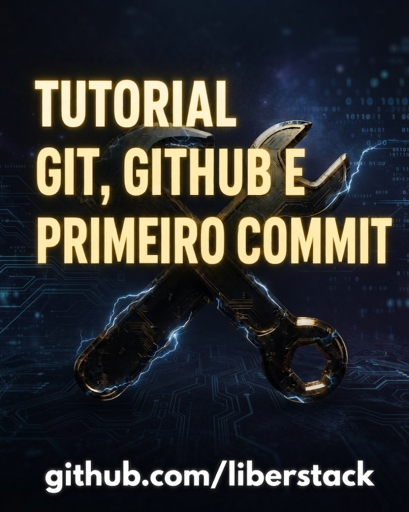

# Aprenda a criar eBooks profissionais com Markdown e Pandoc 

Este livro apresenta um workflow prático para criar e-books em formato EPUB utilizando Markdown e Pandoc. A proposta é ensinar desde os fundamentos da escrita semântica em Markdown até a configuração do ambiente, extensões VS Code e a construção organizada de um e-book, incluindo estrutura de pastas, capítulos, imagens, metadados e comandos no terminal.

**Capítulos**
1. Introdução ao Markdown e à semântica
2. Extensões Visual Studio Code para Markdown
3. Instalação e configuração do Pandoc
4. Linhas de comando e Workflow: construindo o e-book
5. Checklist e Resumo

  

      
    

> R$ 85,00 / ARQUIVO EPUB 

Ao concluir este livro, você terá uma visão prática de como utilizar Markdown e Pandoc para transformar conteúdo estruturado em documentos digitais, mantendo um fluxo de produção simples, organizado e reutilizável para vários formatos. A partir dos conceitos apresentados, você poderá criar uma base sólida para produzir eBooks e outros documentos digitais de forma mais eficiente.

# Tutorial Git, GitHub e primeiro commit 

Este livro apresenta um tutorial prático para aprender Git, comandos GitBash e GitHub do zero, desde os conceitos fundamentais até a realização do primeiro commit + deploy básico. A proposta é ensinar os principais conceitos e comandos do Git, a utilização do GitHub e um workflow básico para versionar e publicar projetos, permitindo que o leitor comece a utilizar controle de versão de forma prática.

**Capítulos**
1. Introdução ao Git e GitHub
2. Instalação e Configuração
3. Primeiro repositório e primeiro commit
4. Linhas de comando e Workflow básico
5. Checklist e Resumo

  

      
    

> R$ 85,00 / ARQUIVO EPUB 

Ao concluir este tutorial, você terá uma base prática para utilizar Git e GitHub no desenvolvimento dos seus próprios projetos. A partir do primeiro repositório e do primeiro commit, você poderá versionar seus arquivos, acompanhar alterações e utilizar o GitHub para armazenar e publicar seus projetos. Mais do que memorizar comandos, a proposta é compreender um workflow simples e reutilizável, criando uma base sólida para continuar evoluindo no desenvolvimento de software.

## Comprar 

> [Telegram ↗](https://t.me/liberstack)     
> Pagamento via PIX / Transferência

## Contato

Criado por Guilherme Ribeiro, Desenvolvedor Web com foco em JavaScript & Python. 

- [GitHub ↗](https://github.com/liberstack)
- [LinkedIn ↗](https://www.linkedin.com/in/grideirodev/)
- [topverbs@gmail.com](mailto:topverbs@gmail.com)

